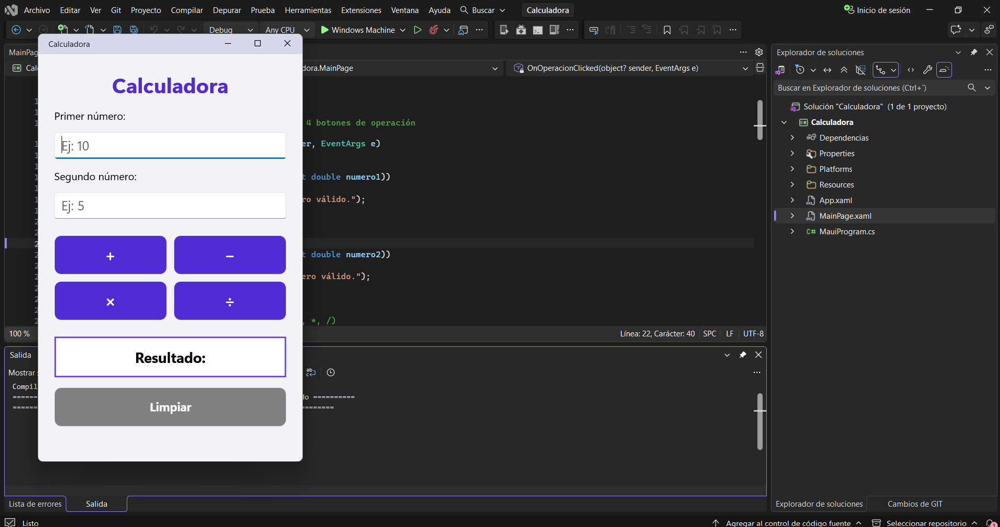
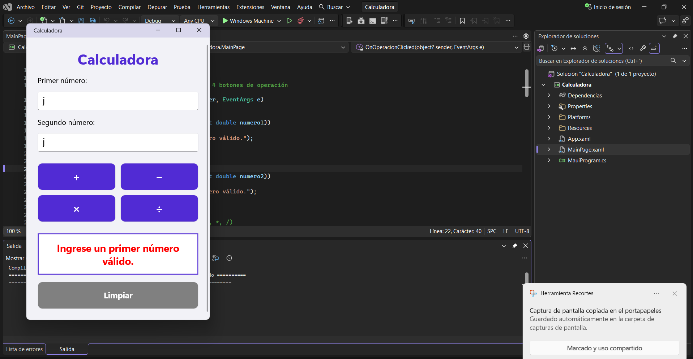
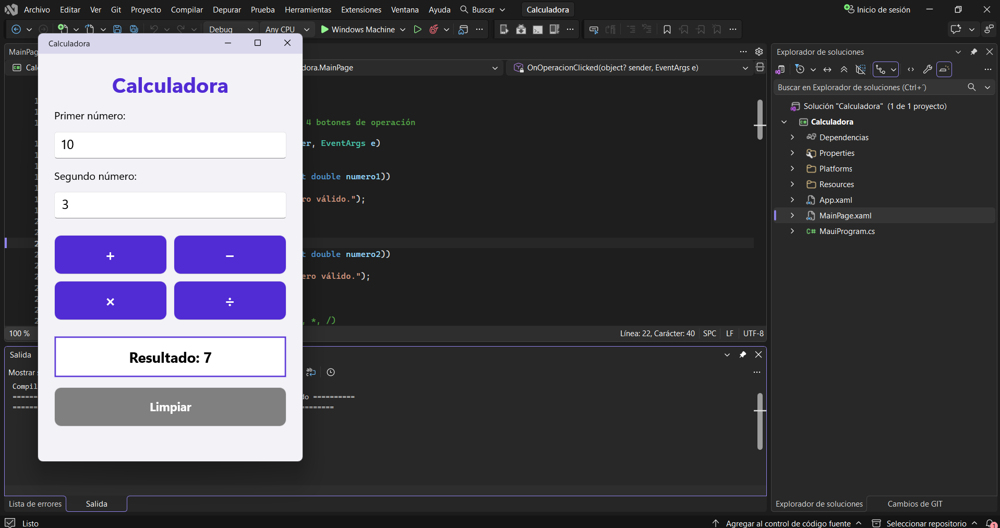
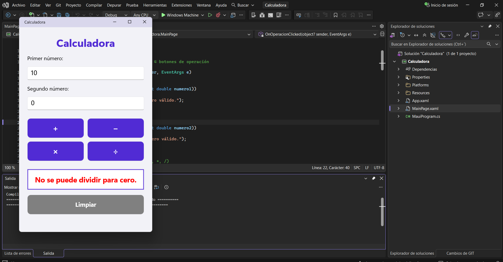
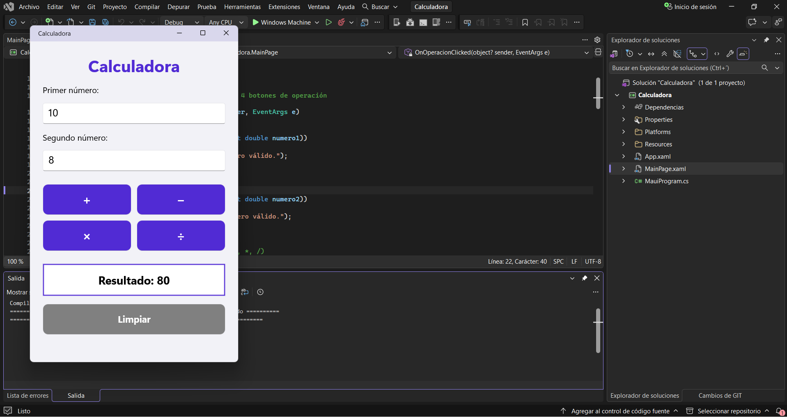

# Calculadora - Aplicación con .NET MAUI

Este proyecto es una aplicación móvil y de escritorio desarrollada con **.NET MAUI**. Su objetivo es realizar las cuatro operaciones aritméticas básicas (suma, resta, multiplicación y división) a partir de dos números ingresados por el usuario, mostrando el resultado en pantalla.

---

## Características Principales

- **Cuatro operaciones básicas:** Suma (`+`), resta (`−`), multiplicación (`×`) y división (`÷`) mediante botones independientes.
- **Interfaz sencilla:** Una sola pantalla (`MainPage`) con dos campos de entrada, los botones de operación, una etiqueta de resultado y un botón para limpiar.
- **Validaciones:** Comprueba que los campos contengan números válidos y evita la división para cero, mostrando mensajes de error en rojo.
- **Botón Limpiar:** Borra los campos y reinicia el resultado para hacer un nuevo cálculo.

---

## Tecnologías utilizadas

- **.NET MAUI** (Interfaz de usuario de aplicaciones multiplataforma)
- **C# / XAML**
- **Visual Studio** (entorno de desarrollo)

---

## Estructura del Proyecto

- `App.xaml`: Configuración y recursos globales de la aplicación.
- `MainPage.xaml`: Diseño de la interfaz (campos, botones y resultado).
- `MainPage.xaml.cs`: Lógica de las operaciones y validaciones (`OnOperacionClicked`).
- `MauiProgram.cs`: Punto de entrada y configuración de la aplicación.

---

## Validaciones implementadas

| Caso | Mensaje mostrado |
|------|------------------|
| Primer número vacío o con formato inválido | `Ingrese un primer número válido.` |
| Segundo número vacío o con formato inválido | `Ingrese un segundo número válido.` |
| División con el segundo número igual a 0 | `No se puede dividir para cero.` |

---

## Capturas de la Aplicación

A continuación, se muestra el funcionamiento de la aplicación en sus diferentes etapas:

### 1. Pantalla Principal

Al iniciar, se muestran los campos "Primer número" y "Segundo número", los cuatro botones de operación, el área de resultado y el botón **Limpiar**.



### 2. Validación de números

Si se ingresa un valor que no es numérico (por ejemplo, una letra), la aplicación muestra un mensaje de error indicando que se debe ingresar un número válido.



### 3. Resta

Con los valores `10` y `3`, al presionar el botón `−` el resultado mostrado es `7`.



### 4. División para cero

Al intentar dividir `10` para `0`, la aplicación evita el error y muestra el mensaje "No se puede dividir para cero."



### 5. Multiplicación

Con los valores `10` y `8`, al presionar el botón `×` el resultado mostrado es `80`.



---

## Cómo ejecutar el proyecto

1. Clonar el repositorio:
   ```bash
   git clone https://github.com/TU-USUARIO/Calculadora.git
   ```
2. Abrir la solución `Calculadora.sln` en **Visual Studio** con la carga de trabajo *Desarrollo de la interfaz de usuario de aplicaciones multiplataforma con .NET (MAUI)* instalada.
3. Seleccionar el destino de ejecución (por ejemplo, **Windows Machine**).
4. Presionar **F5** o el botón de ejecutar para iniciar la aplicación.

---

## Autor

Proyecto desarrollado como práctica de **.NET MAUI** con C# y XAML.
